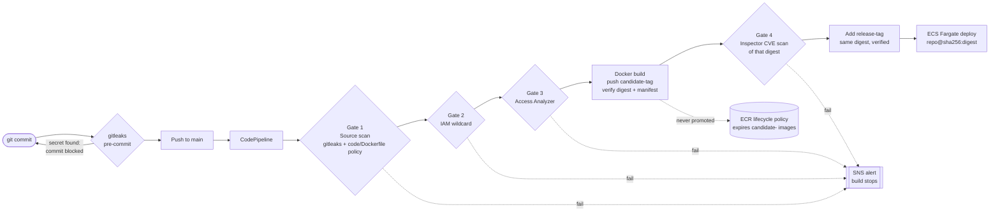

# Pipeline v2: shift-left gates, digest-pinned deploys



**One digest is scanned, promoted and deployed.** No step between Gate 4 and ECS refers to the image by a name that can move.

## What changed from v1, and why

| Change | v1 | v2 | Why |
|---|---|---|---|
| Source/secrets scan | Last gate, after the image was pushed | **Gate 1**, before the build | It scans source, not the image. A problem now fails before any compute is spent or anything reaches ECR. |
| IAM gates | After the image push | **Gates 2–3**, before the build | They inspect IAM role policies, not the image. |
| Inspector | First gate | **Gate 4**, the only gate after the build | It is the only check that needs the image in ECR. |
| Credential detection | Hand-written regexes | **gitleaks** (pinned release, checksum-verified) | A maintained ruleset with entropy and context beats a growing set of custom patterns. |
| Custom scanner scope | Secret regexes | Dangerous Python calls (AST, import aliases resolved) + **Dockerfile policy** | Custom code covers what no off-the-shelf scanner knows about this project. |
| Image tagging | Mutable tag, deployed by tag | Pushed as `candidate-<tag>`; after Gate 4, `release-<tag>` added to the **same digest**; repository **IMMUTABLE** | Only images that passed every gate become releases, and a release tag can never be repointed. |
| Integrity checks | None | After push: ECR digest must equal the pushed digest, and the manifest must be a single image (not an index). After promotion: the release tag must resolve to the scanned digest. | Makes "the deployed image is the scanned image" checked, not assumed. An image index would break that link. |
| Deploy reference | `repo:tag` | `repo@sha256:<digest>` in `imagedefinitions.json` | The deploy names the exact bytes that passed Gate 4. |
| Failed images | Stayed in ECR indefinitely | ECR lifecycle policy (`infra/ecr-lifecycle-policy.json`) | Native ECR, no extra services. |
| Inspector timeout | Treated as "no vulnerabilities" | Treated as a failure | Fail closed. |
| SNS email | Image line always set | `Image: not built (failed before build)` for Gates 1–3; tag **and** digest after the build | Shows the shift-left behaviour, and which exact image failed. |

## Lifecycle policy: why the rule order matters

ECR has no knowledge of what ECS is running, and an image selected by a higher-priority rule cannot be expired by a lower-priority one. So:

1. **`release-*`: keep the newest 20.** Highest priority, so those 20 are protected from every rule below, including an image that still carries a `candidate-` tag.
2. **`candidate-*`: expire after 1 day.** Failed or never-promoted images.
3. **Untagged: expire after 1 day.**

Releases are kept by count, not age: an age rule would eventually delete a stable service's only image. The residual risk is more than 20 consecutive releases whose ECS deploys all fail and roll back, which the pipeline-failure alert surfaces long before. Expiry is asynchronous (within about 24 hours); the security control is promotion, and expiry is housekeeping.

## Gate 1 responsibilities

| Component | Responsibility |
|---|---|
| gitleaks pre-commit hook | Credentials, before they reach GitHub |
| gitleaks in Gate 1 | Credentials anywhere in the checked-out tree (backstop: hooks can be skipped) |
| `scripts/ci_source_scan_gate.py` | Dangerous Python calls; Dockerfile policy |

**Python rules (AST):** `eval`, `exec`, `os.system`, `os.popen`, `pickle.load(s)`, `marshal.load(s)`, `subprocess.*(shell=True)`, `yaml.load` without a `Loader`. Import aliases are resolved (`import subprocess as sp`, `from os import system`). Unparseable Python fails the gate.

**Dockerfile rules** (parser handles line continuations, quoting, multi-assignment ENV/ARG and the `# escape=` directive):

| Rule | Fails when | Why |
|---|---|---|
| `DOCKERFILE_SECRET_ARG` / `_ENV` | An ARG or ENV name looks like a secret (`PASSWORD`, `TOKEN`, `SECRET`, `API_KEY`…), whether or not it has a value | Build args persist in image history; ENV persists in the image config and every container. A value supplied at build time is invisible to any repo scanner, so the rule is a policy, not a detector. Names that point at a secret (`*_PATH`, `*_FILE`, `*_ARN`, `*_URL`…) are allowed. Use `RUN --mount=type=secret` or ECS task-definition `secrets`. |
| `DOCKERFILE_UNPINNED_BASE` | `FROM` with no tag or `:latest` | Builds must be reproducible; the scanned base must be the base that ships. Digest-pinned (`@sha256:`) bases, `scratch` and earlier build stages are allowed. |
| `DOCKERFILE_RUNS_AS_ROOT` | The final stage has no `USER`, or `USER root`/`0` | Least privilege at runtime. |

**Suppressions** must name the rule and give a reason, and are logged:

```dockerfile
# source-scan: allow DOCKERFILE_SECRET_ENV reason="public demo token, rotated monthly"
ENV DEMO_TOKEN=public
```

```python
x = eval(expr)  # source-scan: allow DANGEROUS_CALL:eval reason="constant from config schema"
```

A gitleaks false positive is suppressed with gitleaks' own mechanisms (`gitleaks:allow` comment or a `.gitleaksignore` fingerprint).

**Known limits:** the AST check sees direct calls, so dynamic dispatch (`getattr(os, "system")`) evades it; it is a guardrail, not full SAST (Bandit or Semgrep in production). The Dockerfile parser targets the common syntax, not every BuildKit extension. Gate 1 scans the current tree; Git history is covered by the pre-commit hook and GitHub push protection, because CodePipeline's source artifact has no `.git` directory.

## Next steps (not built)

- **Image signing:** sign the digest after Gate 4 (AWS Signer / Notation) and verify before deploy. ECS has no built-in admission check, so verification would be a pipeline step.
- **Deploy permissions:** only the pipeline role should be able to update the ECS service.
